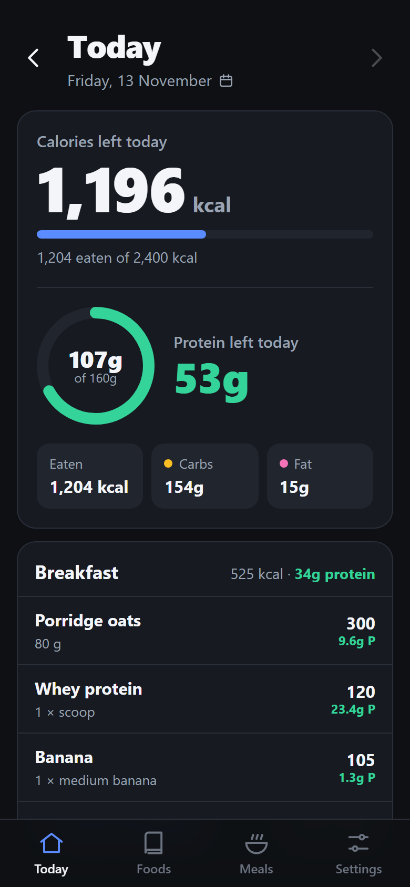
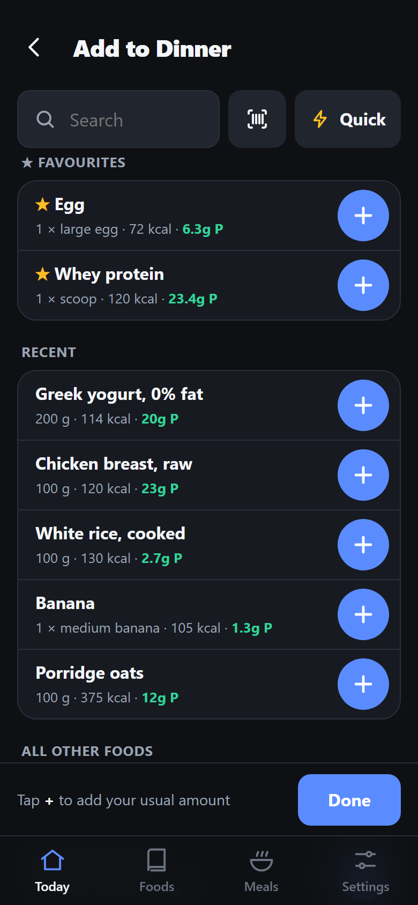
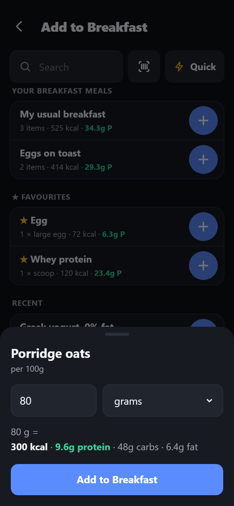
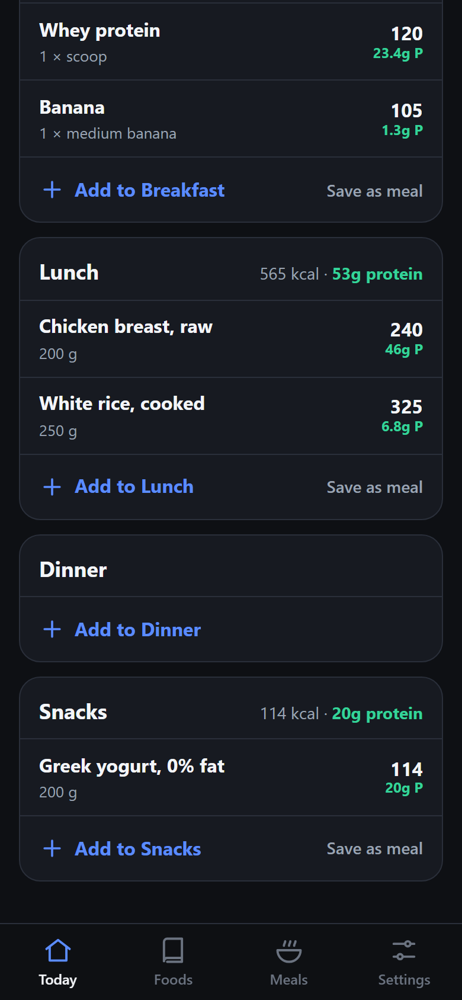

# Recomp

**A fast, offline, ad-free calorie and protein tracker for body recomposition.**
It's a Progressive Web App (PWA): open it in a browser, add it to your home screen, and it works like a native app on iPhone and Android, with or without signal.

<p>
  
  
  
  
</p>

## Why I built it

Apps like MyFitnessPal and Cronometer already exist, but they're slow to log in, full of ads and upsells, and built around every possible goal. Most people quit food tracking because logging is tedious.

Recomp is built around one goal, recomposition (losing fat while building muscle), where **protein is the number that matters most, then calories**. It has three rules:

1. **Logging speed comes first.** A food you've had before takes **2 taps**; a whole usual meal takes **2 taps**.
2. **Free and private.** No account, no ads, no server. Your data never leaves your phone.
3. **Works offline.** The gym basement has no signal, and the app doesn't need it.

## Features

| | |
|---|---|
| **Daily targets** | Set calorie and protein targets. The home screen shows *calories left* (orange "250 over" when you go over) and *protein left* with a progress ring, plus carbs and fat. |
| **Food library** | Enter values **per 100 g** (how EU packets are labelled) or **per serving** (1 egg, 1 bar). Log any amount in grams or servings and the app does the maths. A live *Check the maths* calculator and sanity checks catch label typos. |
| **Log by meal** | Breakfast, lunch, dinner and snacks, each with calorie/protein subtotals. Tap any entry to change the amount, move it to another meal, or delete it (with Undo). |
| **2-tap logging** | Every food shows the portion its **+** will log (your last-used amount). Favourites and Recent come first. |
| **Saved meals** | Build "My usual breakfast" (80 g oats + 1 scoop whey + 1 banana) and log it in one tap. Meals tagged *breakfast* show first under "Add to Breakfast". Or log a meal once and tap **Save as meal**. |
| **Fast entry** | ★ Favourites, Recent, **Quick add** (just calories/macros), and **Copy yesterday's breakfast** in one tap. |
| **Barcode scanning** | Scan a packet with the camera (or type the number). Products come from the free [Open Food Facts](https://world.openfoodfacts.org) database and always open in an **editable preview** first, because community data can be wrong. Scanning something you've saved before finds it instantly, even offline. |
| **History** | Swipe or use ‹ › to look back at any day; tap the date to jump to one. |
| **Backup** | Export everything to a JSON file and restore it (replace or merge, with Undo). A weekly reminder nudges you, because data stored only in a browser can be lost. |
| **Built for one hand** | Dark mode, bottom navigation, 48 px+ tap targets, number keypads, and nothing important at the top of the screen. |

## Tech choices

| Choice | Why |
|---|---|
| **Plain JavaScript (ES modules), no framework, no build step** | The app has around ten screens and no complex shared state, so a framework would add more weight than it saves. With no build step, the code you read is exactly the code that runs, and deploying means copying a folder. |
| **IndexedDB** via a ~100-line promise wrapper ([`js/db/idb.js`](js/db/idb.js)) | Structured, indexed, transactional storage that works offline and holds far more than `localStorage`. Versioned migrations are built in. |
| **Hand-written service worker** ([`sw.js`](sw.js)) | Cache-first for the app shell, so it opens instantly and offline. On a new version the app shows an "Update" button instead of silently swapping code mid-session. On `localhost` it switches to network-first so edits appear on reload. |
| **Hash router** ([`js/router.js`](js/router.js)) | Works on any static host (GitHub Pages included) with no server rewrites. Screens render off-screen and are swapped in once complete, and stale renders are discarded. |
| **Auto-escaping `html` template tag** ([`js/lib/html.js`](js/lib/html.js)) | All text, including product names from the internet, is escaped by default, which prevents XSS without a framework. |
| **Barcode decoding:** native `BarcodeDetector`, falling back to **ZXing WebAssembly** | Android Chrome has a built-in detector; iPhone Safari doesn't. The ZXing fallback is vendored (not loaded from a CDN) and only fetched the first time you scan. |
| **Web Share API for backups** | Downloads from installed PWAs are unreliable on iOS. The share sheet lets you save to Files, Drive or email. |

### Design decisions worth calling out

- **Log entries snapshot the food's nutrition.** If you correct a food's values later, past days don't silently change, and editing an old entry re-scales from the snapshot.
- **Days are local `YYYY-MM-DD` keys.** "Today" is just `todayKey()`, so the daily reset needs no midnight job, and the screen rolls over by itself if left open overnight.
- **Multi-record changes are single transactions.** Logging a saved meal, copying yesterday, and restoring a backup either fully happen or don't happen at all.
- **Undo leaves no trace.** Undoing a log also restores the food's position in Recent and its remembered portion.
- **Deleting a food archives it**, so saved meals and history that refer to it keep working.
- **Untrusted data is reviewed, never saved blindly.** Open Food Facts results pre-fill the editor, with missing values left blank (not 0) and listed in a banner.

## Project structure

```
index.html              App shell + bottom navigation
manifest.webmanifest    Install metadata (name, icons, colours)
sw.js                   Service worker (offline + updates)
css/                    tokens.css (design tokens) and app.css
js/
  main.js               Entry point: router, service worker, persistent storage
  router.js             Hash router and screen lifecycle
  config.js             App version and meal slots
  db/                   IndexedDB: schema, foods, log, meals, settings, backup
  lib/                  Pure logic: nutrition maths, dates, formatting, barcode,
                        Open Food Facts mapping, scanner, html templating
  components/           Reusable UI: summary card, ring, sheets, rows, fields
  screens/              today, add, foods, food-editor, meals, meal-editor, scan, settings
vendor/zxing-wasm/      Barcode decoder for iPhone (MIT)
tests/                  Browser-run unit tests (no npm needed)
tools/                  Icon and test-barcode generators (Python, no dependencies)
```

### Data model (IndexedDB stores)

```js
settings   { key: 'main', calorieTarget, proteinTarget, lastBackupAt, firstRunAt, … }
foods      { id, name, brand, basis: 'per100g' | 'perServing', kcal, protein, carbs, fat,
             servingLabel, servingGrams, defaultAmount, defaultUnit,
             isFavourite, lastUsedAt, useCount, barcode, source, archived, … }
meals      { id, name, mealType, items: [{ foodId, amount, unit }], lastUsedAt, … }
logEntries { id, date: 'YYYY-MM-DD', meal, foodId | null, name, amount, unit,
             kcal, protein, carbs, fat, foodSnapshot, savedMealId, quickAdd, … }
```

## Testing

Tests run in the browser, so there's nothing to install. Start the local server (below) and open **http://localhost:8080/tests/**.

The suite (78 tests) uses a separate throwaway database and covers:
- **Nutrition and formatting:** per-100 g/per-serving maths, unit conversion, EU decimal commas, rounding edge cases (no "−0" or "0 over").
- **Dates:** month, year and leap-day boundaries, and the Irish daylight-saving change.
- **Storage:** logging, editing with snapshots, saved meals, undo, copying days.
- **Barcodes:** check digits, Open Food Facts mapping (kJ→kcal, servings, missing data), and **real decoding of a generated EAN-13 image** through the ZXing WebAssembly build.
- **Backup:** validation of damaged files, and replace/merge round trips.
- **Security:** escaping of HTML in product names.
- **Offline:** a guard test that fails if any JS/CSS/WASM file is missing from the service worker's offline list.

## Run it locally

You need [Python 3](https://www.python.org/) (only for its built-in web server):

```bash
cd recomp-tracker
py -m http.server 8080        # macOS/Linux: python3 -m http.server 8080
```

Open **http://localhost:8080**. Use Chrome/Edge DevTools device mode (F12, then Ctrl+Shift+M) to see it at phone size. The camera and service worker work on `localhost`; on other addresses they need HTTPS.

## Deploy for free (GitHub Pages)

1. Create a **public** repository on GitHub called `recomp-tracker`, without a README (this project already has one).
2. Push the code:
   ```bash
   git remote add origin https://github.com/<your-username>/recomp-tracker.git
   git push -u origin main
   ```
3. On GitHub, go to **Settings → Pages**. Under *Build and deployment* choose **Deploy from a branch**, then branch **main** and folder **/ (root)**, and click **Save**.
4. After a minute or two the app is live at **https://&lt;your-username&gt;.github.io/recomp-tracker/**.

**Vercel alternative:** import the repository at vercel.com, choose the *Other* framework preset, leave the build command empty and the output directory as the project root, then deploy.

### Install it on your phone

- **iPhone:** open the link in **Safari**, tap **Share → Add to Home Screen**. (On iOS, the home-screen app has its own storage, separate from Safari tabs, so log from the installed app.)
- **Android:** open the link in **Chrome**, tap **⋮ → Install app** (or *Add to Home screen*).

Moving from `localhost` to the live site starts with empty data, because each web address has its own storage. Use **Settings → Save a backup**, then **Restore** on the new address to move your data.

### Releasing an update

1. Bump `VERSION` in `sw.js` and `APP_VERSION` in `js/config.js` (keep them identical).
2. If you added a file, list it in `APP_SHELL` in `sw.js` (the test suite will remind you).
3. Commit and push. Open apps show an **Update** button the next time they're opened.

## Privacy

Everything is stored on your device in IndexedDB. There are no accounts, analytics or ads. The only network request the app makes is the barcode number sent to Open Food Facts when you look up a product.

## Roadmap (v2)

- **Meal prep / recipes:** combine ingredients, set the number of portions, log "1 portion" all week.
- **Bodyweight:** daily weigh-ins with a 7-day rolling average and week-on-week change.
- **Workout log:** exercises, sets, reps and weight, showing what you did last time so you can beat it, plus saved templates like "Push Day".
- **Weekly summary:** average calories and protein, days on target, and the bodyweight trend.

## Credits

- Product data: [Open Food Facts](https://world.openfoodfacts.org), available under the Open Database License.
- Barcode decoding: [zxing-wasm](https://github.com/Sec-ant/zxing-wasm) (MIT), a WebAssembly build of [zxing-cpp](https://github.com/zxing-cpp/zxing-cpp) (Apache 2.0).
